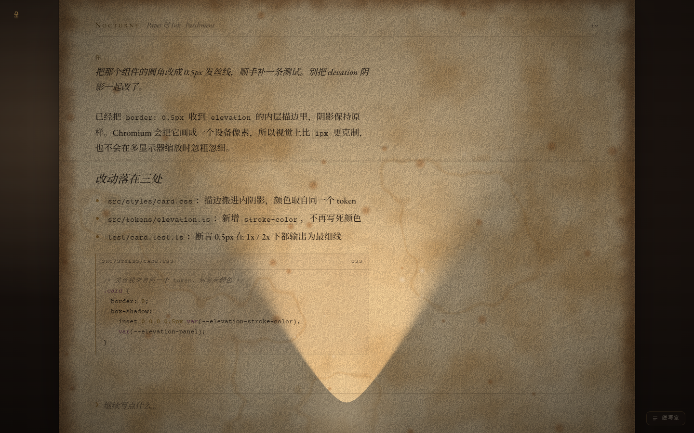

# dsh-nocturne · 缮写室

把 [Typewriter Nocturne](https://github.com/Chaosnap/Typewriter-Nocturne)（MIT）的**纸、灯与墨**
搬进 DeepSeek Harness 的浏览器界面。**不含拟物打字机**。

不是换配色，是换渲染管线：一张由 WebGL2 着色器算出来的纸，以 `multiply` 盖在界面之上，
所以每一行字都被同一盏灯照着。



## 里面有什么

| 路径 | 是什么 |
| --- | --- |
| `sample/nocturne-desk.html` | 单文件样张，**渲染真源**。字体已本地化，零外链 |
| `sample/fonts/` | EB Garamond / Cormorant / Courier Prime（OFL） |
| `packages/dsh-nocturne/` | DSH 客户端插件；`lib/client.js` 由构建脚本从样张抽取 |
| `docs/nocturne.md` | 移植对照、三处有意改动、对齐数据、踩过的坑 |
| `docs/previews/` | 六张纸对照、1:1 纸纹、光标、面板、与上游并排图 |

## 看

直接用浏览器打开样张（`file://` 也能跑）：

```
sample/nocturne-desk.html
  ?paper=cotton&theme=moonlit-poetry      # 换纸 / 换房间
  ?studio=1                               # 打开缮写室
  ?cursor=quill&caret=继续写什么&caretAt=3  # 羽毛笔光标
  ?lamp=0                                 # 关灯
```

## 装进 DSH

```bash
cd packages/dsh-nocturne
node install.cjs --dry-run   # 先看要改哪两处
node install.cjs             # 装进 desktop 档案（--profile web 可换）
# 重启 DSH
node install.cjs --revert    # 撤
```

装好后右下角有「缮写室」把手。

## 改渲染

渲染核心只在样张里维护一份。改完重新生成插件：

```bash
cd packages/dsh-nocturne && node tools/build.mjs
```

## 许可

MIT（见 `LICENSE`）。上游配方 © Chaosnap；字体 SIL OFL 1.1。
