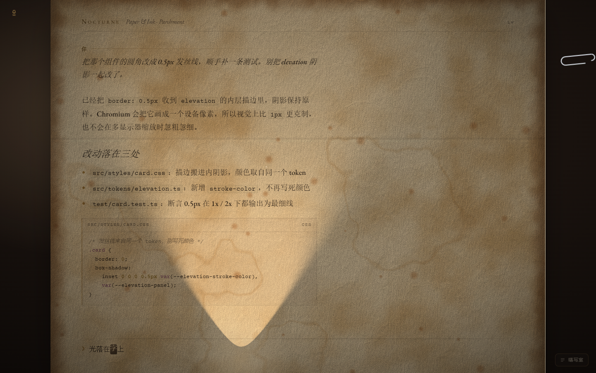
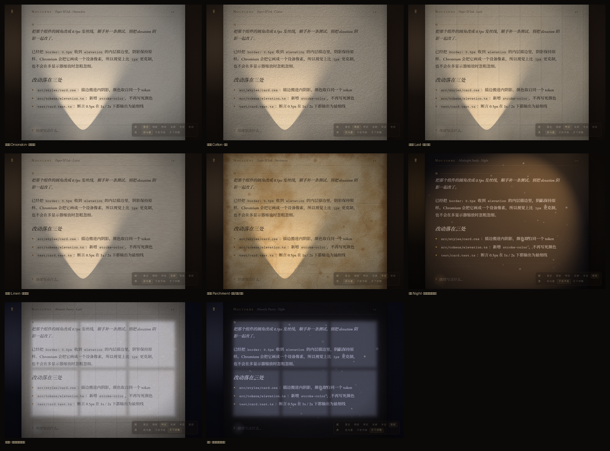
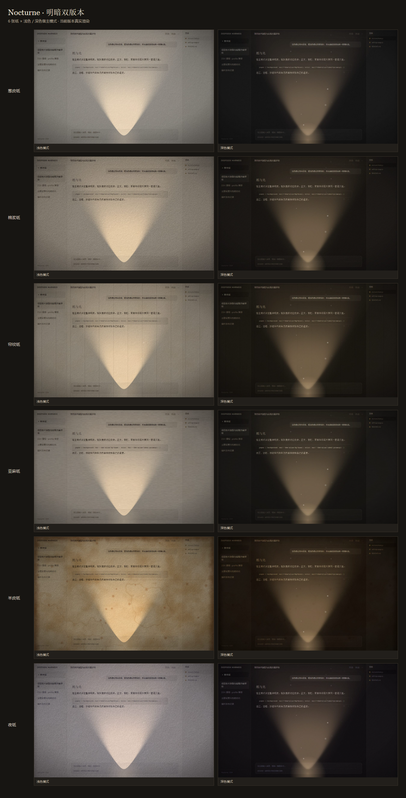

# dsh-nocturne · 缮写室

> DeepSeek Harness 的 WebGL2 古典纸张与物理光影主题插件。

[](LICENSE)
[]()
[]()
[]()

它不是简单的 CSS 调色板覆盖，也不是一张静态贴图，而是把一盏桌前台灯与带纤维肌理的纸张引入了 DeepSeek Harness。

项目移植自 [Typewriter Nocturne](https://github.com/Chaosnap/Typewriter-Nocturne) 的光学与材质渲染管线，剥离了拟物打字机外壳，专注于日常舒适的阅读与书写。纸面纤维与漫射光影由 WebGL2 着色器实时演算，以 `mix-blend-mode: multiply` 叠在文字之上；所有的文本排版、滚动物理与会话交互仍完整交给 DSH 原生处理。



---

## 纸张与空间

材质与光照彼此解耦，支持 **6 款纸张 × 3 组空间**（共 18 种光学组合）。每种搭配均经过针对性调校，确保正文对比度舒适耐读。

每张纸同时提供浅色与深色宿主变体：宿主明暗决定整体明度，纸张保留色相与纹理，房间只控制光源。浅色模式下的夜纸呈现为月白纸，深色模式下的羊皮纸呈现为暮色纸，侧栏、浮层和输入器始终与正文保持同一明暗体系。

- **纸张材质**：
  - **葱皮纸 (Onionskin)**：轻薄韧挺，几近无皱，还原经典洋葱纸的通透质感。
  - **棉浆纸 (Cotton)**：冷压水彩纸手感，圆润毡压纸齿间夹杂着零星长纤维。
  - **帘纹纸 (Laid)**：呈现古法抄纸特有的横向帘线与纵向链线肌理。
  - **亚麻纸 (Linen)**：微密交织的经纬布纹与天然亚麻竹节感。
  - **羊皮纸 (Parchment)**：富有做旧沉淀的微瑕云斑、水渍与边缘浸痕。
  - **夜纸 (Night)**：深色宿主下为深色夜纸，浅色宿主下转为月白纸，分别搭配对应墨色。

- **空间与光影**：
  - **Paper & Ink**：字锤便携小灯，聚拢聚焦，背景深沉古朴。
  - **Midnight Study**：深夜书斋暖调台灯，温润宽阔的光锥笼罩桌面。
  - **Moonlit Poetry**：自轩窗倾泻而下的清冷漫射月光，静谧舒展。





> [查看全部 18 张独立效果图 →](docs/previews/gallery/)

---

## 交互细节与原生保护

视觉增强服务于文字，绝不牺牲基础输入体验。所有动态效果均内置严谨的原生避让与降级逻辑：

| 墨迹光标 (Ink Caret) | 羽毛笔光标 (Quill Caret) |
| :---: | :---: |
|  |  |

- **光标跟随与输入法避让**：提供「墨迹」与「羽毛笔」两款定制光标，紧随输入落点。中文输入法（IME）组合输入中、鼠标划词拖选或坐标测量异常时，**毫秒级自动退回系统原生光标**，杜绝候选框遮挡或打字跳闪。
- **纸夹滚动条**：右侧滚动条模拟为别在纸缘的回形针（支持银、黄铜、金、黑四种质地），随滚动伴随细微的物理倾角与弹簧回弹。**滚动物理与滑动惯性完全保留原生浏览器行为**。
- **漫射微光与无障碍**：光锥内的微弱尘埃粒子与光晕仅占用极低算力，且**严格遵循系统的「减少动态效果」（`prefers-reduced-motion`）设置**，开启后自动冻结动画粒子。
- **硬件降级保障**：在无 WebGL2 支持或显卡驱动崩溃等环境中，自动退回平滑静态纸色，确保核心交互与文字可读性不中断。

---

## 原生设置集成

插件无缝嵌入 DSH 官方设置体系。打开 **设置 → 缮写室**，即可直接调整全部视觉项：


- **复用宿主 React**：直接接入官方设置槽，零二次注入运行时，布局风格与 DSH 及 `claude-style` 保持统一。
- **参数即调即显**：纸张切换、台灯开关、光照强度、光锥广角、颗粒与尘埃微调均即时响应并自动保存。
- **桌面端设置可靠持久化**：针对 DSH 桌面端随机端口导致 `localStorage` 容易失效的问题，内置本地文件存储机制（`$DSH_HOME/cache/dsh-nocturne/settings.json`），同时向后兼容 Web 端的浏览器缓存回退。
- **皮肤共存策略**：与第三方主题（如 `dsh-claude-style`）并存时，可在设置中选择「自动适配」、「仅叠纸张材质（保留其配色）」或「完全接管配色」。

---

## 免安装离线预览

无需启动服务或安装插件，直接用浏览器打开内置的单文件样张即可预览全套视觉效果（英文字体均已本地化）：

```text
sample/nocturne-desk.html
```

支持通过 URL 参数直接查看指定组合：

```text
?paper=cotton&theme=moonlit-poetry     # 棉浆纸 + 月光主题
?studio=1&cursor=quill                 # 羽毛笔光标与调参台
?lamp=0                                # 熄灭台灯，仅看纸纹
```

---

## 安装与卸载

### 前提条件

- DeepSeek Harness `0.2.x`
- Node.js `18.0` 或更高版本

### 安装

```bash
cd packages/dsh-nocturne

# 预检安装变更
node install.cjs --dry-run

# 执行正式安装（写入桌面版档案，支持通过 --profile web 切换）
node install.cjs
```

安装完成后**重启 DSH**，即可在「设置 → 缮写室」中看到配置面板。

### 卸载

```bash
cd packages/dsh-nocturne
node install.cjs --revert
```

> **提示**：卸载脚本具备幂等与干净回滚特性，仅精确移除本插件的注册登记与 bundle，不影响其他插件在 `package.json` 中的后续修改。

---

## 控制台快捷 API

在控制台可通过全局对象 `__dshNocturne` 快速调整参数：

```javascript
__dshNocturne.use('cotton');                                      // 切换纸张材质
__dshNocturne.use('parchment', { intensity: 1.35, grain: 0.25 }); // 调整光照与颗粒强度
__dshNocturne.theme('midnight-study');                             // 切换环境光主题
__dshNocturne.lamp(false);                                         // 临时关灯
__dshNocturne.off();                                               // 暂时停用纸面渲染
```

---

## 本地开发与构建

```bash
npm ci            # 安装开发依赖
npm run build     # 重新构建客户端、宿主脚本与样张
npm test          # 运行测试（包含基于真实无头 Edge 的多材质渲染回归）
npm run check     # 产物漂移检查与全量测试
```

- 核心渲染管线位于 `packages/dsh-nocturne/src/core/`
- 原生设置页位于 `packages/dsh-nocturne/src/settings-page.js`
- 架构设计、着色器推导与渲染细节参见 [移植与设计说明](docs/nocturne.md) 与 [开发文档](docs/development.md)。

---

## 许可与致谢

- 本项目采用 [MIT License](LICENSE) 授权。
- 纸张与光影配方移植自 [Typewriter Nocturne](https://github.com/Chaosnap/Typewriter-Nocturne)（MIT License，© Chaosnap）。
- EB Garamond、Cormorant Garamond 和 Courier Prime 字体遵循 [SIL Open Font License 1.1](sample/fonts/)。
