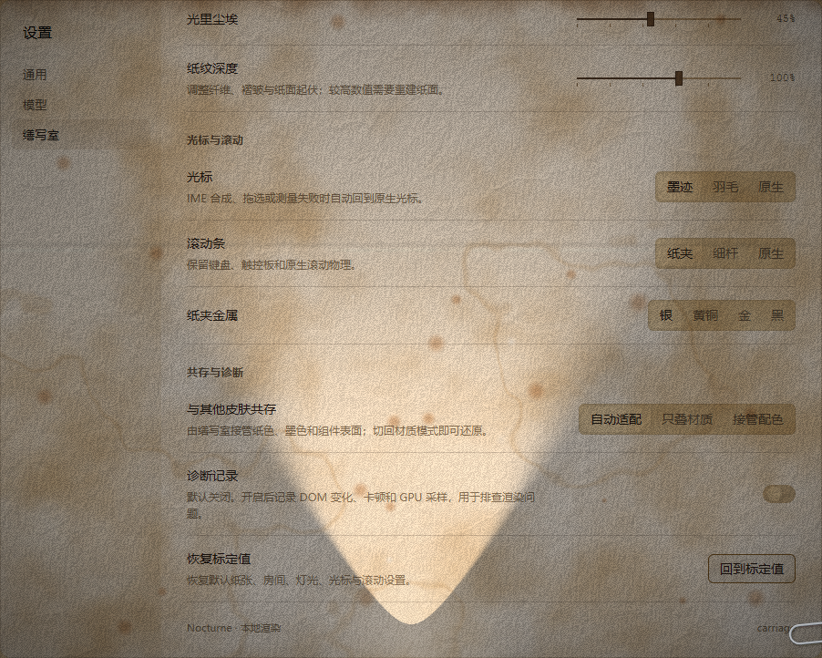
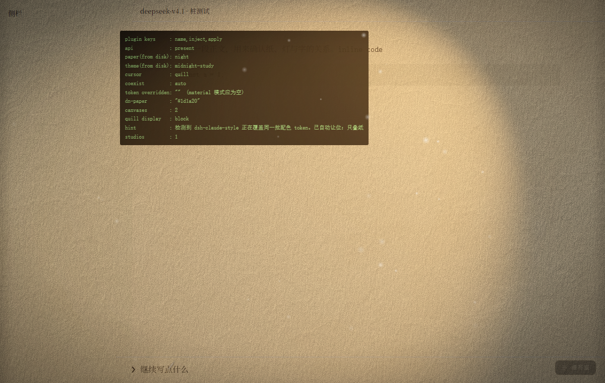
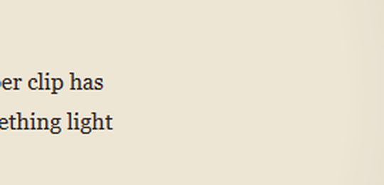

# Nocturne · 纸、灯与墨

> 取代 `docs/design-plan.zh.md` §4.6 与 §6.2 里"用 SVG feTurbulence 近似纸纹、不复用 GLSL"的决定。
> 那一版出来的东西是一张静态贴图——没有光，所以不像纸。

---

## 1 · 为什么第一版不像

| | Typewriter-Nocturne | v1（`sample/p0-parchment.html`） |
| --- | --- | --- |
| 纸面 | WebGL2 双 pass：surface 出 albedo + 法线，light pass 算辐照度 | 一层 `feTurbulence` 灰噪声 |
| 光照 | 锥体灯 + 平方反比 + Lambert + `1−e^{−E·k}` 曝光 | 无 |
| 合成 | canvas 以 `mix-blend-mode: multiply` 盖在文字上 | 背景色直绘 |
| 暗角 | 着色器内的 `smoothstep` 渐晕 + CSS 的 `#vignette` | 无 |
| 结果 | 一张被灯照着的纸 | 一块米色 |

差别不在配色，在**渲染管线**。配色可以照抄，管线不能近似。

## 2 · 逐层移植对照

| 上游 | 本仓库 |
| --- | --- |
| `lib/nocturne/lighting/paper-light.ts` 的 SURFACE / LIGHT 两段 GLSL | `sample/nocturne-desk.html` 里同名两段，**未改一字**（唯一新增 `uPaper`，见 §4） |
| `app/nocturne/light-model.ts`（`irradiance` / `windowGobo` / `toneMap`） | 同名 JS 函数逐行移植 |
| `lib/nocturne/lighting/glow-layer.ts`（光池、尘埃、灯焰、光标辉光） | `GlowLayer` 类逐行移植 |
| `app/nocturne/papers.ts` 六张纸 + 墨色 + 16 色 ANSI | `PAPERS` 原样 |
| `app/nocturne/themes.ts` 三套主题 | `THEMES` 原样 |
| 字族 EB Garamond / Courier Prime / Cormorant（OFL） | `sample/fonts/` 本地化，25 个 woff2 共 792 KB |

渲染分三层，与上游一致：

```
#sheet  background: 纸色
  #text   ← 正文（DOM 里的字，不是 canvas）
  #paper  ← multiply：albedo × irradiance
  #glow   ← screen：光池 / 尘埃 / 灯焰
  #vignette
```

## 3 · 三个有意的改动（其余一律照搬）

### 3.1 纸纹按纸的物理尺寸缩放 —— `uPaper`

上游的噪声频率是按 ~660×620 的纸调的。同一组频率铺到 1200px 的纸上，斑块相对变小，
观感从"陈年纸的云斑"变成"麻点"。所以低频结构（云斑、纤维束、水渍、烧边）统一除以
`uPaper = √(W·H)/700`，**高频纸齿（`noise(p*1.9)`）、帘纹、麻纹、锈斑保持像素级**——
它们是真·物理尺寸，不该跟着画布放大。

### 3.2 灯座从"打字机小车"改挂"输入光标"

上游的灯装在小车上，随光标横向移动。去掉打字机后，若照搬，光锥会永远挤在左边缘
（正文界面的光标总在左）。改成：**灯座钉在纸心，只随光标偏移 ±30%**。
光锥仍是构图主体，但保留了"光跟着你写的地方走"的手感。

### 3.3 环境光下限 0.55 → 0.64

上游 `ambientFloor()` 保证墨/纸 ≥ 4.5:1。实测：这正好够等宽的终端字，
但衬线散文笔画细、字面小，同样的下限让正文发灰（实测 p3 亮度 70，上游同区域 45）。
下限抬到 0.64 后 p3 落到 52、纸面 p85 保持 125——差值从 55 提到 73，逼近上游的 79。
这是唯一一处"照抄会难看"的地方，理由如上，不是随手调的数字。

## 4 · 对齐验证

同一视口（`1440×900`）、同一张纸（parchment）、同一套灯预设（TN balanced：intensity 1、
spread 74°、reach 1、softness 0.65、film grain 0.1），与上游官方截图逐项比：

| 指标 | 上游 | 本实现 |
| --- | --- | --- |
| 纸面亮度 均值 | 112.5 | **117.2** |
| p50 | 114.7 | **113.9** |
| p95 | 177.8 | **177.8** |
| 峰值 | 215.2 | **212.2** |
| 正文墨/纸亮度差（p3 vs p85） | 79.2 | **73.0** |

逐像素一致做不到（上游那张截图里有 3D 打字机，构图也不同），但**色调分布已经落在同一个桶里**。
并排图见 `docs/previews/reference-vs-nocturne.png`。

> 顺带记一个坑：`mix-blend-mode` 的元素只要被包进一个带 `z-index` 的容器，就会被关进
> 隔离栈里与页面断开，multiply 退化成直接覆盖（实测三组对照：裸挂 `body` 正常合成，
> 包一层 fixed 容器后只剩源色）。所以两片 canvas 直接挂在 `document.body` 下。

## 4.5 · 六张纸 × 三个房间

上游的纸与主题是**正交**的：主题管桌子与灯，纸管纸与墨。所以不是一张纸，是 6 × 3 = 18 种组合。

| id | 名称 | 纸色 | 性格（决定它长什么样的 surface 参数） |
| --- | --- | --- | --- |
| `onionskin` | 葱皮纸 | #f2f1ea | **上游默认**。极薄极平，crinkle 仅 0.08 |
| `cotton` | 棉浆纸 | #eee6d5 | 毡压而非褶皱：cold-press 水彩纸那种圆润纸齿，纤维里还有零星长丝（felt 1.0） |
| `laid` | 帘纹纸 | #f1e9d6 | 横向帘线 4.2px + 纵向链线 96px |
| `linen` | 亚麻纸 | #ebe5d8 | 3.4px 交叉织纹 + 竹节（slub） |
| `parchment` | 羊皮纸 | #efdfbd | 云斑 mottle 1.0 + 做旧 0.75：狐斑、水渍、折痕、烧边 |
| `night` | 夜纸 | #1d1a20 | 暗纸浅墨，为夜间工作 |

| id | 房间 | 灯源 | 房间色 |
| --- | --- | --- | --- |
| `paper-and-ink` | Paper & Ink | 字锤小灯（carriage） | #241a14 |
| `midnight-study` | Midnight Study | 桌面台灯（desk-lamp，#ffb35c） | #140f0b |
| `moonlit-poetry` | Moonlit Poetry | 月窗（moonlight，#c9d4ff） | #0e0e1a |

插件中，每张纸还会按 DSH 宿主明暗切换到对应变体；样张没有宿主明暗，仍按纸张自身的原生身份渲染。

样张底部两条切换条就是这六个纸与三个房间，深链一一对应：
`?paper=cotton&theme=moonlit-poetry`。

比对图：`docs/previews/papers-matrix.png`（整幅）+ `docs/previews/papers-texture.png`（1:1 纸纹）。

> 注：本仓库样张的默认纸是 **parchment**（跟随这个工作区的命名），上游默认是 **onionskin**。
> 想完全照上游，把 `SETTINGS.paper` 改成 `'onionskin'`。

### 顺带修掉的一个真 bug

做这张矩阵时发现的：月光的窗格我原先借用了台灯的 `softness`（0.65），算出来柔边 30px，
比窗格本身还宽——3×2 的方窗糊成一片白。上游的窗光是一组**独立参数**（窗格数列、斜度、柔边），
照搬过来后窗格立刻成形（见 `papers-matrix.png` 第三行）。

## 4.8 · 墨迹光标

上游的 `components/block-cursor.tsx` 是一块**洇进纸里的墨**：边缘软、边上稍深（墨积在那里）、
底下那个字用纸色反白；它躺在纸光之下，所以灯把它和字一起照亮。

| 上游 | 本仓库 |
| --- | --- |
| `SINK` / `SPREAD` / `FRESH` / `FRESH_HALO` 四组关键帧 | 原样（1700ms 呼吸 + 650ms 静置） |
| `.tn-ink-blot` 的 `border-radius: 22% 14% 18% 12% / 12% 20% 10% 18%`、双层内阴影、`blur(.3px)` | 原样 |
| 失焦只剩淡轮廓（`opacity .45` 描边） | 原样 |
| 暗纸取浅墨 | 原样 |


### 兼容层（这一层是新写的）

上游的光标跟着 xterm 的 `CursorFrame` 走——那是一套现成的字格坐标。宿主这边没有，得自己量：

| 场景 | 处理 |
| --- | --- |
| `contenteditable`（DSH 编辑器的形态） | `Range.getClientRects()` 取末矩形；零尺寸时用节点包围盒兜底 |
| `input` / `textarea` | canvas 量前缀宽度 + `scrollLeft` |
| **字宽** | 按光标下那个字的实际字形量：中日韩 ~1em、拉丁 ~0.55em，墨块才不挤字 |
| **IME 合成中** | 立刻让位：墨块藏起、`caret-color` 还原，候选框位置不受影响 |
| **非折叠选区** | 让位（选了字就不该有块光标） |
| 量不出来 / 光标移出视口 | 让位并还原原生光标——宁可没有装饰，不能没有光标 |
| `prefers-reduced-motion` | 不呼吸、不溅墨 |
| **性能** | 量选区要强制回流，所以只在"确实动过"或每 250ms 兜底时才量；否则沿用上次位置 |
| 卸载 | 移除监听、清掉 `caret-color`，宿主恢复原样 |

开关：样张里它默认开着；插件里 `__dshNocturne.caret(false)` 关掉，宿主自己的光标立刻回来。

样张深链可以单看它：`?caret=继续写什么&caretAt=3`（把光标放到第 3 个字后面）。

## 4.9 · 缮写室（DSH 原生设置页）

0.5 起，插件不再挂载上游悬浮 Studio，而是通过官方 `settings.section` 注册独立导航项。
页面使用宿主 React 与语义 token；分组、设置行、开关、分段控件、响应式和字体与 claude-style 对齐。



| 组 | 控件 | 落到哪个参数 |
| --- | --- | --- |
| 纸张与房间 | 六张纸色卡、三种房间 | `SETTINGS.paper` / `SETTINGS.theme` |
| 灯光与纸纹 | 台灯开关、六个即时渲染滑杆 | uniforms 与 surface pass |
| 光标与滚动 | 三种光标、三种滚条、金属和细杆参数 | `cursorMode` / `scrollbar` |
| 共存与诊断 | 三种共存口径、诊断开关、恢复标定值 | `coexist` / `diagnostics` |

**羽毛笔也是移植的**，不是画的图：`quill-cursor.tsx` 里那套几何（笔脊三次贝塞尔、
羽枝 30 + 22 根按 `sin` 分布求宽、两道分叉的高斯凹陷、锥形笔脊、角质笔杆、鎏金笔箍与笔尖）
全部照搬，只在原点上画一支再整体右倾 35°。笔尖落在基线上，整支高 1.15 行。

样张仍保留 `buildStudio()` 供离线演示；插件设置页使用独立的 `settings-page.js`，两者不再共享上游 UI。

## 4.10 · 桌面版与皮肤共存

### 为什么需要宿主半

DSH 桌面版每次启动把 web 服务端口设成 0（随机端口），GUI 的 origin 随之变化。
浏览器 `localStorage` 按 origin 隔离——不落盘的话，**用户每重启一次皮肤就回到默认**。

宿主半因此存在，只做一件事：`/dsh-nocturne/settings` 上读写一个 JSON 文档，
路径 `$DSH_HOME/cache/dsh-nocturne/settings.json`，临时文件 + `rename` 原子替换，
只接受回环地址。写法照装机里的 `dsh-claude-style`（`ctx.inject(["webServer"], …)` +
`scope.effect` + `server.register({kind: "prefix", path, handler})`），
因为那是在这台机器上唯一被验证过的写法。

客户端是「磁盘真源 + 本地缓存」：启动 GET → 合并 → 覆盖缓存；改动 700ms 防抖 PUT。
宿主半没装时 fetch 失败，静默退回缓存，样张与纯 web 版照常工作。

### 与 dsh-claude-style 共存

它用 371 处 `!important` 覆盖同一批 `--dsw-alias-*`，同时又定义了 139 个 `--dsh-claude-*`
自定义属性——后者是**稳定且不依赖 DOM 结构**的指纹，据此探测它在不在场。

| 口径 | 行为 |
| --- | --- |
| 自动（默认） | 探测到就"只叠材质"，否则"接管配色" |
| 只叠材质 | 不写任何 `--dsw-alias-*`，只画纸与灯——两套皮肤叠着用 |
| 接管配色 | 内联 `!important`；内联 important 高于它样式表里的 important，所以本皮肤赢 |

### 组件表面：气泡、输入框、菜单

它把这些"表面"定义成 `--dsw-specific-*`，浅色口径下气泡是 `#f4f2f3`——一张浮在纸上的白卡片。
这里按纸重算，写在 **body** 上（它把这些 token 定义在 `body[data-dsh-claude-style]` 上，
根元素只是继承，继承输给本地声明）：

| token | 混墨比例 | 用在哪 |
| --- | --- | --- |
| `--dsw-specific-bubble` | 7% | 消息气泡 |
| `--dsw-specific-input-major` | 5% | 输入框 |
| `--dsw-specific-menu` | 4% | 菜单 |
| `--dsw-specific-selector` | 6% | 选择器 |
| `--dsw-specific-sidebar-fill` | 3% | 侧栏 |

朝**墨色**混而不是直接刷纸色：深色纸上 `paper().ink` 是浅的，同一条公式在夜纸上自动变成
"略亮的纸"，不需要两套值。

顺手修掉了气泡动画的闪白：入场动画是 `transform: scale(0) → scale(1)`，会把元素提成合成层，
那一瞬间它按 `#f4f2f3` 原色画在纸上；改成纸的调子之后，这一跳几乎看不出来。



上图是桩测试的实际输出：磁盘设置取回了 `night / midnight-study / quill`，
检测到 claude-style → 自动让位 → `--dsw-alias-bg-base` 保持空（未接管）、
`--dn-paper` 是夜纸、羽毛笔 `display:block`、提示文案正确。

## 4.11 · 纸夹滚条

上游的滚动条是一枚夹在纸上的回形针（`components/scroll-clip.tsx`），而它的坐标系是终端：
滚动量来自 xterm 的 `viewportY / baseY`。搬进 DOM 要换一种量法。

几何照搬：画布 100×31 单位、屏幕 84×26px、纸边在 88 单位处，所以弯头正好探出纸外约 10px；
静止倾角 −0.1rad；跟随用弹簧（5Hz / 阻尼 0.72），倾斜用 3.2Hz / 0.35，倾角封顶 ±0.22rad。

**找滚动容器**：从视口中线取一点 `elementFromPoint`，沿祖先链往上找第一个 `overflow-y: auto|scroll`
且溢出 >8px 的元素，优先取高度超过视口 55% 的那个。代价与树的大小无关——上万节点的会话里，
逐元素问 `overflow` 是几十毫秒级的阻塞。找不到就每 500ms 重试（正文栏可能比插件晚挂上）。

**挂在哪里**：横向挂在**纸缘**（整扇窗的右缘），不挂在正文栏的右缘。正文栏的右缘上有字，
夹子本体有 74px 长，挂上去会压住最后几个字；上游的夹子也是挂在纸边上的。

**原生滚条让位**：隐藏前后各量一次 `clientWidth`，用内边距把差补回去，正文不会横向跳一下。



夹子的本体有 74px 长，所以握点必须落在纸缘——落在正文栏的右缘就会压住每行最后几个字。

### 为什么没有搬选区的"墨滴化开"

试过，做出来了，**又撤了**（0.3.1）。原因不是技术，是取舍：

上游的终端里，xterm 自己的选区被设为不可见，动画才有干净的底子。浏览器里没有这一层隔离——
要让画面干净，就得压一条 `::selection { background: transparent }`，等于**把系统选区藏起来**。
拖选时用户看不到系统给的反馈，只看到我们那套逐字动画；这跟系统自己的选区是根本冲突，
不是能调好的参数。

**只保留颜色**（0.3.2）：`::selection` 用纸自己的调子——浅色纸取房间的描金
`rgba(176,138,74,.28)`，深色纸取纸自带的月白 `rgba(196,188,255,.20)`；行为一条不动，
也不加 `!important`（宿主若另有口径，让它赢）。取色复用上游 `themes.ts` / `papers.ts`
的 `selection`，不新造颜色。

技术上也留了一条记录：动效最初用 2D canvas 画，取色器证明**画布自己画满了、屏幕上却没有它**
（8161 个非透明像素、取样点正确、z-index 与插入位置都试过），它根本没有进入合成；
换成 DOM 元素才出现。所以在这个界面里，覆盖层的正确姿势是 DOM，不是自建画布层。

## 5 · 交付物

| 路径 | 是什么 |
| --- | --- |
| `src/core/` | **渲染真源**：六张纸、灯、光标、滚动条与 Studio |
| `sample/nocturne-desk.html` | 生成的单文件样张，支持离线打开与深链参数 |
| `sample/fonts/` | 本地化的 EB Garamond / Courier Prime / Cormorant（附完整 OFL） |
| 仓库根（`package.json`） | DSH 组合包本体：`dsh.bundle` 指向 `cordis.patch.yml`；客户端与宿主产物由共享 ES 模块构建 |
| `docs/previews/nocturne-*.png` | 三张纸的 headless 渲染 |
| `docs/previews/dsh-plugin-shell.png` | 插件在模拟 DSH 外壳里装载后的样子 |
| `docs/previews/ink-cursor.png` / `ink-cursor-dsh.png` | 墨迹光标：样张（input）与插件（contenteditable） |
| `docs/previews/studio-panel.png` | 缮写室面板（样张） |
| `docs/previews/quill-cursor.png` | 羽毛笔光标 8× |
| `docs/previews/dsh-plugin-studio.png` | 插件里的缮写室 |

样张深链：`?paper=cotton|laid|linen|onionskin|parchment|night&lamp=0&theme=midnight-study`。

## 6 · 安装插件

```bash
node install.cjs --dry-run      # 先看要改什么
node install.cjs                # 装进 desktop 档案
# 重启 DSH
node install.cjs --revert       # 撤掉
```

也可以直接在 DSH 的「插件」页填仓库地址 `https://github.com/rinDBeans/dsh-nocturne`，由 DSH 自己把它作为组合包装入。

它只做两件可逆的事：把包拷进档案的 `node_modules`、在 `package.json` 里登记依赖与 bundle
（装载条目由包自带的 `cordis.patch.yml` 提供，与 dsh-dream-skin 同一套做法）。
**没有自动执行**：GUI 需要一次性令牌，本机拿不到，所以装完无法当场验证；
留给你一次 `--dry-run` + 一次重启，比替你赌一把更稳。

## 7 · 没做的

- **拟物打字机**（Three.js 模型、字锤、滑架、压纸杆）——按需求去掉。
- **敲击音效**、**拉绳开关**——上游有，本移植不做。
- **墨滴选区**——已否决，保留系统选区行为，只改颜色。
- v1 中的**蜡封、落字动画、终端 ANSI、独立原生设置页**——未进入当前版本；恢复前需另立验收标准。

当前设置使用右下角 Studio 面板与控制台 API；持久化采用宿主磁盘真源 + 本地缓存。
